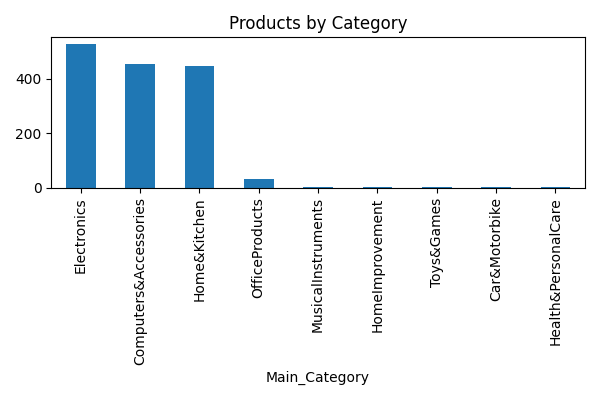
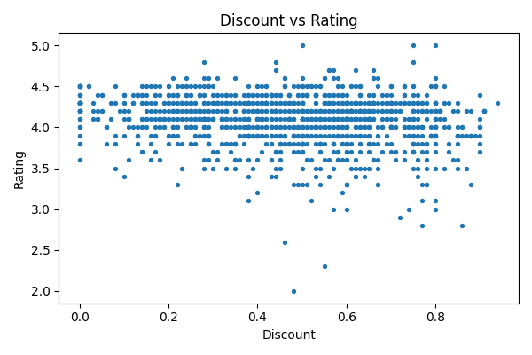
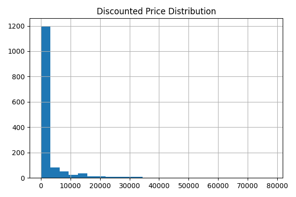
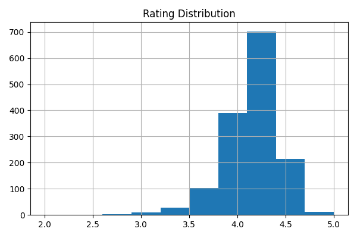

# 🛒 Amazon Products: Data Cleaning & Analysis

Cleaning and analysis of an Amazon India product dataset to understand categories, pricing, discounts, and customer ratings, with business recommendations.

## 📌 Overview
| | |
|---|---|
| **Dataset** | 1,465 Amazon India products, 16 columns |
| **Tools** | Python (pandas, NumPy, Matplotlib) |
| **Deliverables** | Cleaning script, charts, and an analysis report |

## 🧹 Data Cleaning
The raw data stores numbers as text (for example `₹1,099`, `64%`, `24,269`), so the script:
- strips extra spaces from column names and removes duplicate rows
- converts **prices** from text with `₹` and commas to numbers
- converts **discount** from `"64%"` to `0.64`
- converts **rating** and **rating count** to numeric
- creates a `Main_Category` column from the full category path (e.g. `Computers&Accessories|Cables|...` → `Computers&Accessories`)
- removes rows that are still missing key values and reports how many were removed

## 📊 Key Findings
- **Electronics** is the largest category, followed by Computers & Accessories and Home & Kitchen.
- The average discount is **47.7%**: nearly half of the list price.
- Most products are rated **above 4 stars** (average 4.10 / 5).
- Prices are **heavily skewed** by a few expensive products, so the median is more representative than the mean.
- A small number of products receive a very large share of the reviews.
- Discount level alone does **not** strongly explain ratings.

<p align="center">
  
  
</p>
<p align="center">
  
  
</p>

## 💡 Recommendations
1. Prioritize Electronics and Computer Accessories.
2. Promote highly rated products that also have many reviews.
3. Track the performance of heavily discounted products.
4. Report the median price alongside the average.
5. Encourage reviews for newer products.

## ▶️ How to Run
```bash
pip install pandas numpy
python data_cleaning.py
```
Reads `data/amazon.csv` and saves `data/amazon_cleaned.csv`.

## 📁 Project Structure
```
├── data_cleaning.py
├── data/amazon.csv
├── images/          # Charts
└── reports/Amazon_Data_Analysis_Report.docx
```

## 👤 Author
**Waseem Mahmoud** · [LinkedIn](https://www.linkedin.com/in/waseem-mahmoud-a34154213) · [GitHub](https://github.com/waseemalali)
